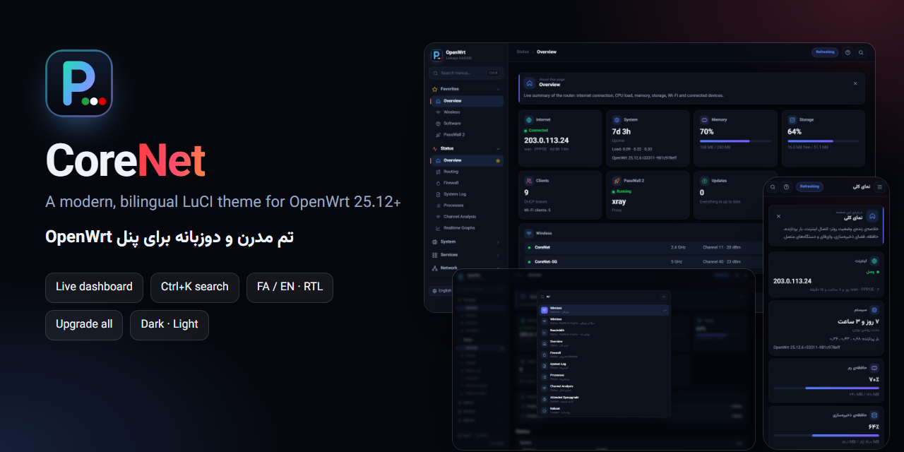

# CoreNet — LuCI theme for OpenWrt

<a href="https://hits.sh/github.com/Plus98ir/luci-theme-corenet/"></a>
<a href="https://github.com/Plus98ir/luci-theme-corenet/releases/latest"></a>


<div align="center">
<table><tr><td><a href="https://github.com/Plus98ir/luci-theme-corenet/blob/main/README.md">🇺🇸 English</a></td><td><b>🇮🇷 فارسی</b></td></tr></table>
</div>



<div dir="rtl">

**CoreNet یک تم مدرن و دوزبانه (فارسی / انگلیسی) برای پنل وب OpenWrt (یعنی LuCI) است.** منوی بالای صفحه را با یک منوی کناری گروه‌بندی‌شده عوض می‌کند و داشبورد زنده، جستجوی منو، کارت راهنما برای هر صفحه و دکمه‌ی **آپگرید همه** اضافه می‌کند. کل تم حدود ۱۵۰ کیلوبایت است.

### امکانات

- 🧭 **منوی کناری گروه‌بندی‌شده:** هر صفحه آیکون دارد. گروه‌ها آکاردئونی‌اند؛ با باز کردن یکی بقیه بسته می‌شوند. هر صفحه‌ای را با ستاره‌ی ☆ کنارش به «منتخب‌ها» اضافه کنید.
- 🔎 **جستجوی منو:** `Ctrl+K` یا `/` را بزنید و فارسی یا انگلیسی تایپ کنید (`رمز`، `پسوال`، `wifi`، `backup`…). با کلیدهای جهت و Enter مستقیم به صفحه بروید.
- 📊 **داشبورد زنده در صفحه‌ی نمای کلی:** اینترنت و IP عمومی، مدت روشن بودن و بار پردازنده، حافظه‌ی رم، فضای ذخیره‌سازی (با هشدار بالای ۸۰٪)، دستگاه‌های متصل، رادیوهای وای‌فای با کانال و قدرت و تعداد کلاینت، وضعیت پروکسی (PassWall، PassWall 2، OpenClash، HomeProxy، Nikki) و تعداد آپدیت‌های پکیج.
- ⬆️ **آپگرید همه:** دکمه‌ای کنار «Update lists…» در صفحه‌ی نرم‌افزارها. اول لیست پکیج‌ها را نشان می‌دهد، ماژول‌های کرنل را رد می‌کند، `apk upgrade` را روی خود روتر در پس‌زمینه اجرا می‌کند و گزارش زنده می‌دهد؛ اگر پنل وسط کار ری‌استارت شود هم آپگرید ادامه پیدا می‌کند.
- 💡 **راهنما در هر صفحه:** یک کارت کوتاه توضیح می‌دهد صفحه چه کاری می‌کند و برای تنظیمات حساس (WAN، فایروال، فلش و…) هشدار می‌دهد.
- 🌐 **فارسی / انگلیسی:** با یک کلیک منو، راهنما و داشبورد عوض می‌شوند. در حالت فارسی چیدمان راست‌به‌چپ می‌شود و عددها فارسی‌اند. فونت وزیرمتن داخل تم است و بدون اینترنت هم کار می‌کند.
- 🌗 **تیره · روشن · خودکار**، 📱 **مناسب موبایل** با منوی کشویی و نوار ثابت Save & Apply، 🔐 **صفحه‌ی ورود اختصاصی**.
- 🧩 **سازگار با همه‌ی برنامه‌ها:** روی اجزای استاندارد LuCI ساخته شده و همه‌ی اپ‌ها، از جمله اپ‌های Lua مثل پسوال، بدون مشکل کار می‌کنند.

### نصب

**از پنل وب (ساده‌ترین روش)**

۱. در **System › Administration › Repo Public Keys** این کلید را یک بار اضافه کنید (پکیج‌های CoreNet با آن امضا می‌شوند):

</div>

```
-----BEGIN PUBLIC KEY-----
MFkwEwYHKoZIzj0CAQYIKoZIzj0DAQcDQgAEddziHMBCZj3GlDV2RsEBaoz1O2MP
QrpFaEhmFk9456QWGmnq9HSk6ECbrauI9sN+2+KPvVDnyKDP75yLtu2lNA==
-----END PUBLIC KEY-----
```

<div dir="rtl">

۲. فایل `.apk` را از [Releases](https://github.com/Plus98ir/luci-theme-corenet/releases/latest) دانلود کنید و از **System › Software › Upload Package…** نصب کنید.<br>
۳. در **System › System › Language and Style** تم **CoreNet** را انتخاب کنید و صفحه را با `Ctrl+F5` دوباره باز کنید.

**آپدیت خودکار در صفحه‌ی نرم‌افزارها:** این خط را به فایل `/etc/apk/repositories.d/customfeeds.list` اضافه کنید تا نسخه‌های جدید بعد از «Update lists…» در تب Updates بیایند:

</div>

```
https://corenetbase.com/luci-theme-corenet/apk/packages.adb
```

<div dir="rtl">

**از SSH:**

</div>

```sh
curl -sL -o /etc/apk/keys/corenet.pem https://github.com/Plus98ir/luci-theme-corenet/releases/latest/download/corenet.pem
echo https://corenetbase.com/luci-theme-corenet/apk/packages.adb >> /etc/apk/repositories.d/customfeeds.list
apk update && apk add luci-theme-corenet
```

<div dir="rtl">

### تنظیمات

- **زبان پیش‌فرض:** `uci set luci.corenet.lang=fa` (مقدارها: `auto`، `fa`، `en`) و بعد `uci commit luci`. هر مرورگر می‌تواند با دکمه‌ی زبان آن را عوض کند.
- **تم پیش‌فرض:** `uci set luci.corenet.theme=dark` (مقدارها: `dark`، `light`، `auto`).
- **یادداشت‌های خودتان روی صفحه‌ها:** فایل `/www/luci-static/corenet/custom.js` را بسازید و `window.CN_NOTES` را با مسیر صفحه و متن فارسی و انگلیسی پر کنید (نمونه در بخش انگلیسی). منتخب‌های پیش‌فرض هم با `window.CN_PINS` در همین فایل تعیین می‌شوند.
- **اجرای یک دستور بعد از «آپگرید همه»:** فایل اجرایی `/etc/corenet/post-upgrade` بسازید؛ بعد از هر آپگرید موفق اجرا می‌شود.

### نیازمندی‌ها

OpenWrt نسخه‌ی **۲۵.۱۲ یا جدیدتر** (مدیر پکیج apk). پکیج به معماری وابسته نیست و روی همه‌ی روترها نصب می‌شود.

### مجوز

Apache-2.0. استایل پایه‌ی اجزای فرم از `luci-theme-bootstrap` گرفته شده و فونت وزیرمتن (OFL) است.

</div>
