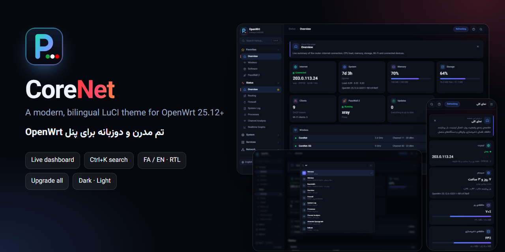
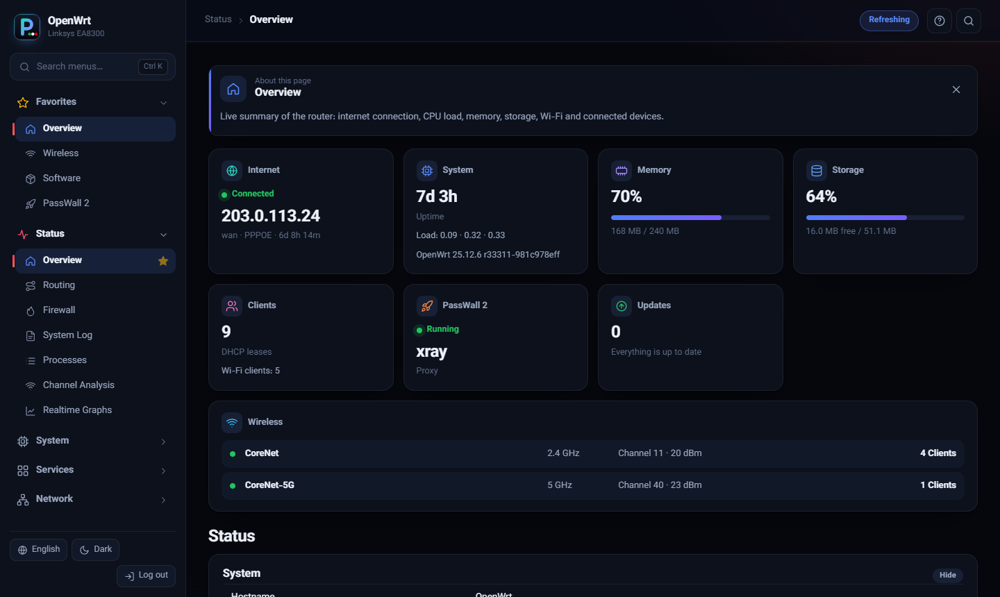
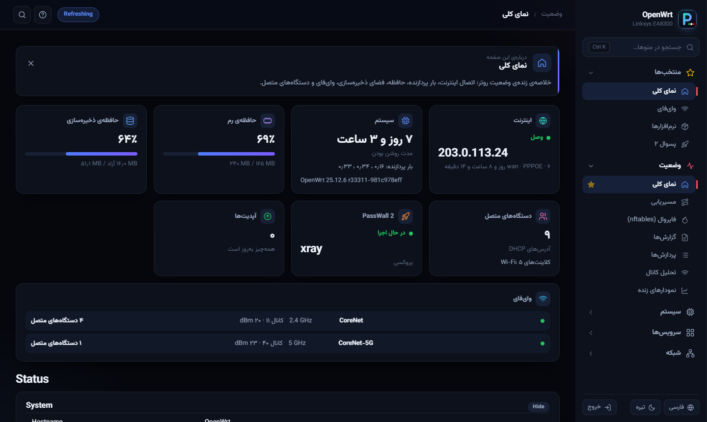
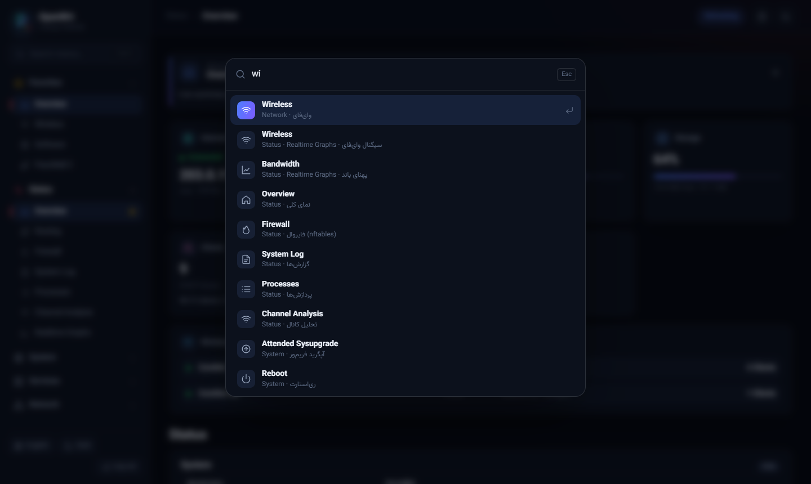
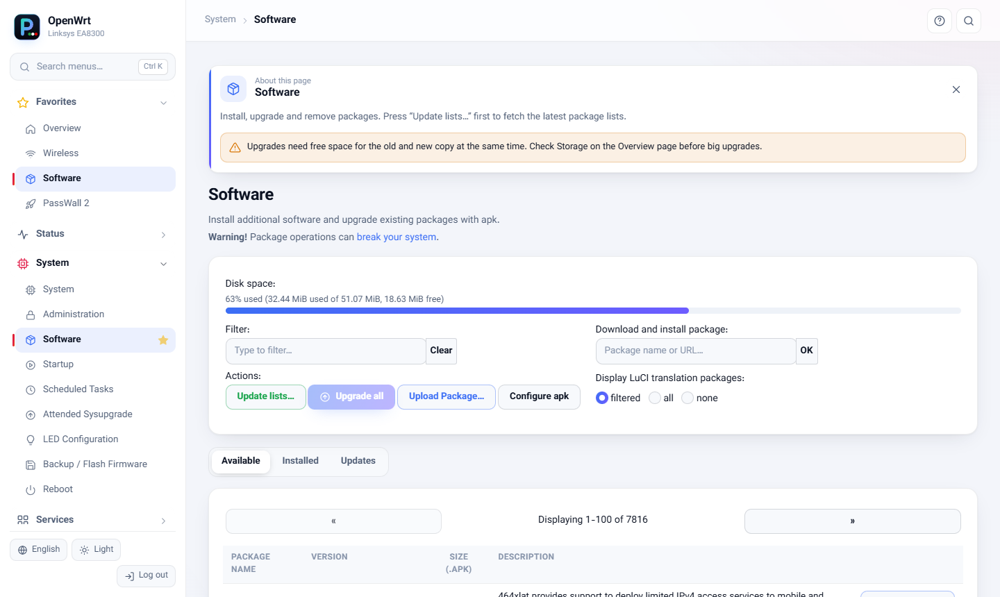
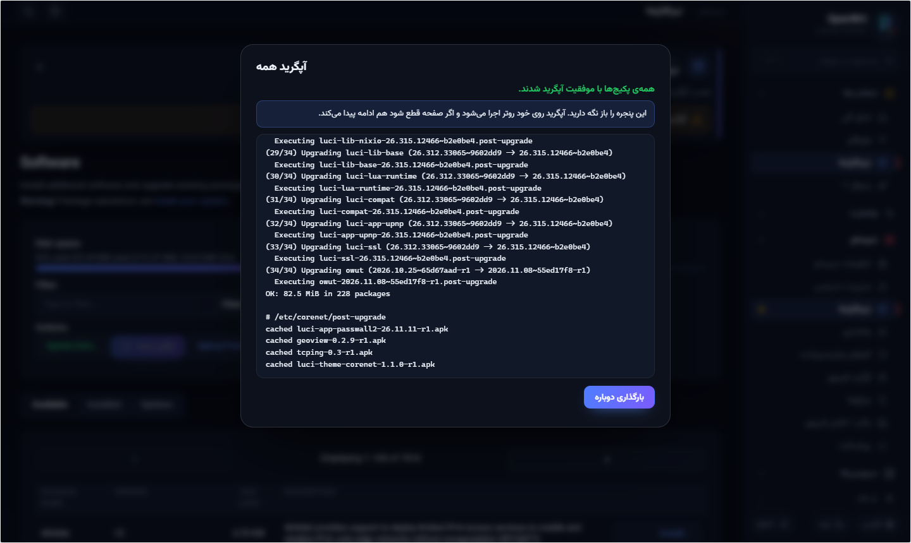
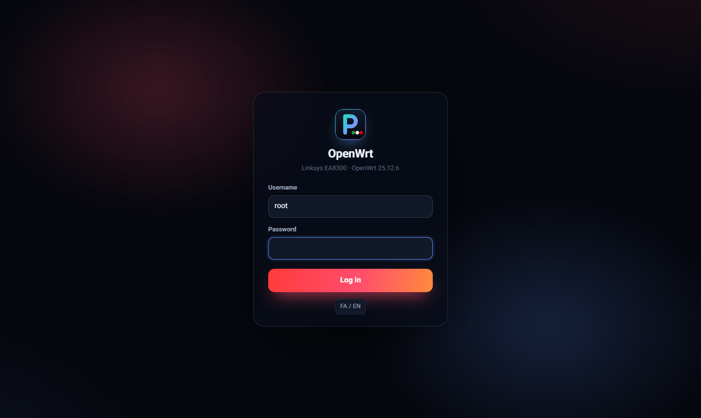
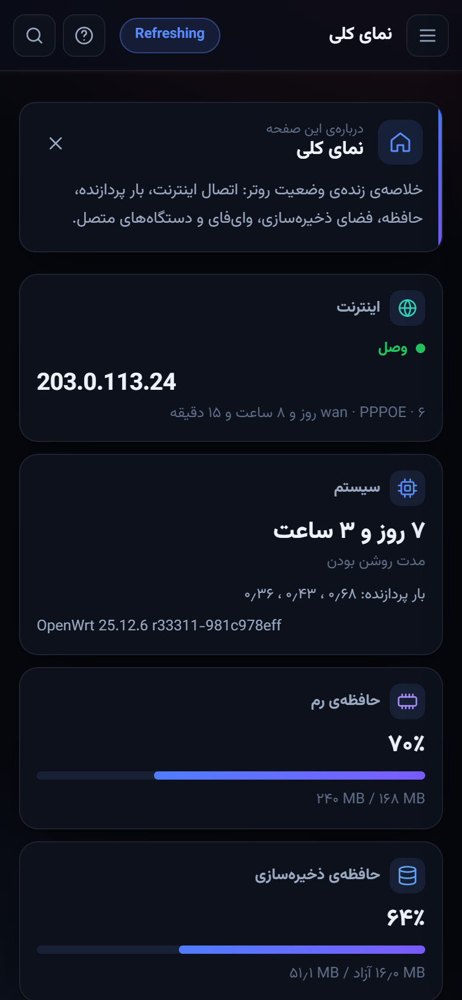
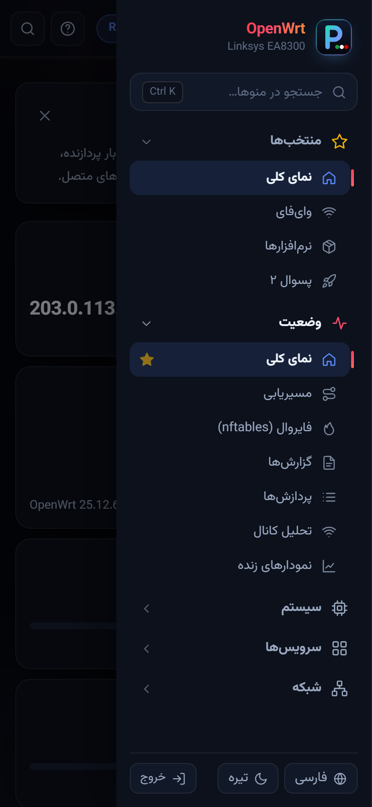
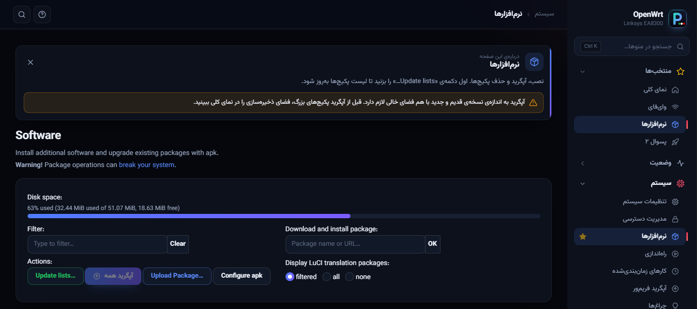

<h1 align="center">CoreNet — LuCI theme for OpenWrt</h1>

<p align="center"><a href="https://hits.sh/github.com/Plus98ir/luci-theme-corenet/"></a> <a href="https://corenetbase.com/#support"></a> <a href="https://github.com/Plus98ir/luci-theme-corenet/releases/latest"></a> <a href="https://openwrt.org/"></a></p>

<div align="center">

[ &nbsp;**English**](README.md) &nbsp;&nbsp;|&nbsp;&nbsp; [ &nbsp;**فارسی**](README.fa.md)

</div>

<details>
<summary><b>☕ Support · حمایت</b> — USDT (TRC20) / TRX</summary>
<br>
<p align="center"></p>

```
TA53aFyGNfSAcrCaJi9QmA9x5W47nPJcf7
```

> [!WARNING]
> **TRON network only.** Sending from ERC20 / BEP20 will lose the funds.<br>
> **فقط شبکه‌ی TRON.** ارسال از ERC20 یا BEP20 پول را از بین می‌برد.

</details>



**CoreNet is a modern, bilingual (English / Persian) theme for the OpenWrt web interface (LuCI).** It replaces the top menu with a grouped sidebar, adds a live dashboard, a menu search, a help card on every page and an **Upgrade all** button — and it is only ~150 KB.

### Screenshots

| Dashboard (dark) | Dashboard in Persian (RTL) |
|---|---|
|  |  |
| **Menu search (Ctrl+K)** | **Light theme + Upgrade all** |
|  |  |
| **Upgrade all, live log** | **Login page** |
|  |  |

| Mobile | Mobile menu | Help card |
|---|---|---|
|  |  |  |

### Features

| | |
|---|---|
| 🧭 **Grouped sidebar** | Icons for every page, accordion groups (opening one closes the others), and **Favorites**: pin any page with the ☆ next to it. |
| 🔎 **Menu search** | Press `Ctrl+K` or `/` and type in English or Persian (`wifi`, `رمز`, `backup`, `پسوال`…). Arrow keys + Enter to jump. |
| 📊 **Live dashboard** | On Status › Overview: internet + public IP, uptime and load, memory, storage (warns above 80 %), connected clients, Wi-Fi radios with channel / power / clients, proxy status (PassWall, PassWall 2, OpenClash, HomeProxy, Nikki) and available package updates. |
| ⬆️ **Upgrade all** | A button next to *Update lists…* on System › Software. Shows the list first, skips kernel modules, runs `apk upgrade` on the router in the background with a live log, and keeps going even if the web panel restarts. |
| 💡 **Help on every page** | A short card explains what the page does, with warnings for risky settings (WAN, firewall, flashing…). Bilingual. |
| 🌐 **English / Persian** | One click switches the menus, help and dashboard; Persian mirrors the layout to right-to-left and uses Persian digits. Vazirmatn font is built in (works offline). |
| 🌗 **Dark · Light · Auto** | Remembered per browser. |
| 📱 **Mobile ready** | Slide-out menu, stacked forms, scrollable tabs and a sticky *Save & Apply* bar. |
| 🔐 **Own login page** | Clean, centered login with the router name and model. |
| 🧩 **Works with everything** | Built on the standard LuCI widgets, so every app (including Lua apps like PassWall) keeps working. |

### Install

**From the web panel (easiest)**

1. **System › Administration › Repo Public Keys** — paste this key once (CoreNet packages are signed with it):
   ```
   -----BEGIN PUBLIC KEY-----
   MFkwEwYHKoZIzj0CAQYIKoZIzj0DAQcDQgAEddziHMBCZj3GlDV2RsEBaoz1O2MP
   QrpFaEhmFk9456QWGmnq9HSk6ECbrauI9sN+2+KPvVDnyKDP75yLtu2lNA==
   -----END PUBLIC KEY-----
   ```
2. Download the `.apk` from [Releases](https://github.com/Plus98ir/luci-theme-corenet/releases/latest), then **System › Software › Upload Package…**
3. **System › System › Language and Style** → pick **CoreNet**, then reload the page with `Ctrl+F5`.

**Get updates in System › Software** — add this line to `/etc/apk/repositories.d/customfeeds.list`:
```
https://corenetbase.com/luci-theme-corenet/apk/packages.adb
```
New versions then show up in the *Updates* tab after *Update lists…*.

**From SSH**
```sh
curl -sL -o /etc/apk/keys/corenet.pem https://github.com/Plus98ir/luci-theme-corenet/releases/latest/download/corenet.pem
echo https://corenetbase.com/luci-theme-corenet/apk/packages.adb >> /etc/apk/repositories.d/customfeeds.list
apk update && apk add luci-theme-corenet
```

### Settings

| What | How |
|---|---|
| Default language | `uci set luci.corenet.lang=fa` (`auto` / `fa` / `en`) and `uci commit luci`. Each browser can still switch with the button. |
| Default theme | `uci set luci.corenet.theme=dark` (`dark` / `light` / `auto`). |
| Your own notes on pages | Create `/www/luci-static/corenet/custom.js`:<br>`window.CN_NOTES = { 'admin/network/wireless': { en: 'Keep 2.4 GHz at 20 dBm', fa: '...' } };` |
| Default favorites | In the same file: `window.CN_PINS = [ 'admin/status/overview', 'admin/network/wireless' ];` |
| Run something after *Upgrade all* | Make `/etc/corenet/post-upgrade` executable — it runs after a successful upgrade. |

### Requirements

OpenWrt **25.12 or newer** (apk package manager, ucode LuCI). The package is architecture-independent (`noarch`).

### Build from source

The package follows the LuCI feed layout (`luci-theme-corenet/Makefile`). Copy it into `package/` of an OpenWrt SDK with the `luci` feed installed and run `make package/luci-theme-corenet/compile`. The GitHub workflow in `.github/workflows/build.yml` does exactly this, signs the package and publishes the feed.

### License

Apache-2.0. The base widget styles come from `luci-theme-bootstrap` (Apache-2.0), font: Vazirmatn (OFL).
